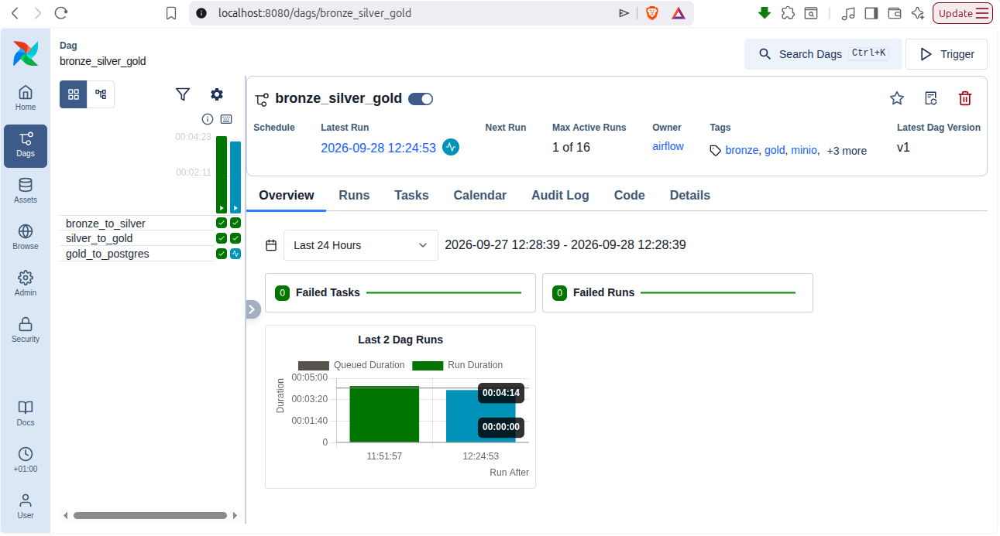
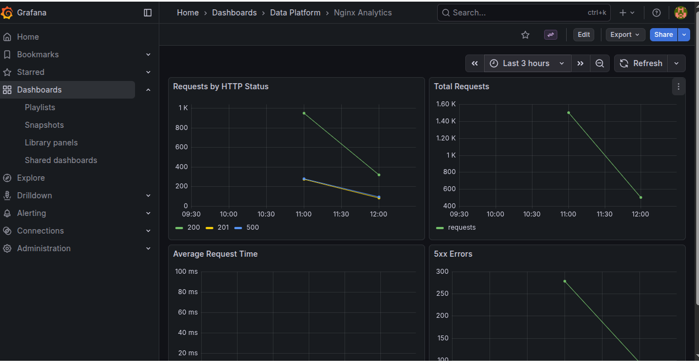

# Kubernetes-Based Data Engineering Platform

A complete, production-grade local data engineering platform demonstrating modern data pipeline architecture using Kubernetes, Apache Spark, Apache Airflow, and MinIO. This project showcases ETL/ELT patterns, distributed processing, orchestration, and observability in a single reproducible environment.

## 📊 Architecture Overview

```
┌─────────────────────┐
│  Traffic Sources    │
│  (NGINX/Generator)  │
└──────────┬──────────┘
           │ HTTP requests
           ▼
    ┌──────────────┐
    │    NGINX     │ → JSON-formatted access logs
    │  (Ingestion) │
    └──────┬───────┘
           │ logs
           ▼
    ┌──────────────────┐
    │  Fluent Bit      │ → Collects, parses, delivers
    │  (Log Pipeline)  │
    └──────┬───────────┘
           │ events
           ▼
    ┌──────────────────────────────┐
    │         MinIO (S3)            │
    │   ┌──────────────────────┐   │
    │   │  BRONZE (Raw JSON)   │   │
    │   │  ↓                   │   │
    │   │  SILVER (Parquet)    │   │
    │   │  ↓                   │   │
    │   │  GOLD (Aggregated)   │   │
    │   └──────────────────────┘   │
    └──────┬───────────────────────┘
           │
    ┌──────┴────────┬────────────┐
    │ Spark Jobs    │ Airflow    │
    │ (Transform)   │ (Orch.)    │
    └──────┬────────┴────────────┘
           │
           ▼
    ┌──────────────────┐
    │  PostgreSQL      │ → Analytics database
    │  (Analytics DB)  │
    └──────┬───────────┘
           │
           ▼
    ┌──────────────────┐
    │    Grafana       │ → Dashboards & monitoring
    │  (Visualization) │
    └──────────────────┘
```

### Data Flow

**Bronze → Silver → Gold → PostgreSQL → Grafana**

1. **Ingestion**: NGINX generates structured JSON logs
2. **Collection**: Fluent Bit collects, parses, and delivers logs to MinIO (Bronze layer)
3. **Raw Storage**: Bronze bucket contains immutable raw data (JSON format)
4. **Bronze to Silver**: Spark job parses nested JSON, extracts NGINX fields, converts types, creates partition columns
5. **Silver Storage**: Silver bucket contains cleaned, validated data (Parquet format, partitioned by event_date and hour)
6. **Silver to Gold**: Spark job aggregates by status code, date, hour; computes request counts and average response times
7. **Gold Storage**: Gold bucket contains business-ready aggregations (Parquet, hourly summaries)
8. **Loading**: Spark writes Gold data to PostgreSQL analytics database via JDBC
9. **Visualization**: Grafana queries PostgreSQL and renders dashboards

## 🎯 Key Technologies

| Component | Technology | Version | Purpose |
|-----------|-----------|---------|---------|
| **Container Platform** | Kubernetes / Minikube | 1.28+ | Orchestrates all workloads |
| **Data Ingestion** | NGINX | Latest | HTTP API endpoint, access log generation |
| **Log Collection** | Fluent Bit | Latest | Collects and delivers logs to S3 |
| **Object Storage** | MinIO | Latest | S3-compatible data lake (Bronze/Silver/Gold) |
| **Processing Engine** | Apache Spark | 4.0.4 | Distributed ETL/ELT transformations |
| **Spark Operator** | Spark Operator | Latest | Kubernetes-native Spark job execution |
| **Orchestration** | Apache Airflow | 3.2.2 | DAG scheduling and monitoring |
| **Metadata DB** | PostgreSQL | 16 | Airflow metadata and analytics database |
| **Visualization** | Grafana | Latest | Dashboards and alerting |
| **Container Runtime** | Docker | Latest | Container image building and running |
| **Package Manager** | Helm | 3.10+ | Kubernetes chart deployment |

## 📁 Repository Structure

```
k8s-data-platform/
├── README.md                           # This file
├── infrastructure/                     # Kubernetes manifests and configurations
│   └── kubernetes/
│       ├── namespace.yaml              # data-platform and observability namespaces
│       ├── nginx/                      # NGINX ingestion server
│       │   ├── configmap.yaml          # NGINX JSON log configuration
│       │   ├── deployment.yaml         # NGINX deployment
│       │   └── service.yaml            # NGINX service
│       ├── fluent-bit/                 # Fluent Bit log collection
│       │   ├── configmap.yaml          # Fluent Bit pipeline config
│       │   └── daemonset.yaml          # Fluent Bit daemonset
│       ├── minio/                      # Object storage
│       │   └── values.yaml             # MinIO Helm chart values
│       ├── spark/                      # Spark and Spark Operator
│       │   ├── spark-rbac.yaml         # Service account and RBAC for Spark
│       │   └── spark-operator-values.yaml # Spark Operator Helm values
│       ├── postgres/                   # Airflow metadata database
│       │   └── airflow-postgres.yaml   # PostgreSQL deployment for Airflow
│       ├── postgres-data/              # Analytics database
│       │   └── postgres.yaml           # PostgreSQL deployment for analytics
│       └── airflow/                    # Airflow orchestration
│           ├── values.yaml             # Airflow Helm chart values
│           ├── spark-rbac.yaml         # RBAC for Airflow to create SparkApplications
│           └── dags/                   # DAG deployment location
├── spark/                              # Spark jobs and container image
│   ├── Dockerfile                      # Spark image with dependencies
│   ├── jobs/                           # PySpark transformation scripts
│   │   ├── bronze_to_silver.py         # Parse JSON, clean, partition
│   │   ├── silver_to_gold.py           # Aggregate by hour/status
│   │   └── gold_to_postgres.py         # Write to PostgreSQL
│   ├── bronze-to-silver.yaml           # SparkApplication manifest
│   ├── silver-to-gold.yaml             # SparkApplication manifest
│   └── gold-to-postgres.yaml           # SparkApplication manifest
├── airflow/                            # Airflow DAGs
│   └── dags/
│       └── bronze_silver_gold.py       # Main orchestration DAG
├── monitoring/                         # Observability stack
│   └── grafana/
│       ├── values.yaml                 # Grafana Helm chart values
│       ├── dashboards/
│       │   └── nginx-analytics.json    # NGINX analytics dashboard
│       ├── provisioning/               # Grafana provisioning configs
│       └── dashboard-configmap.yaml    # ConfigMap for dashboard
├── ingestion/                          # Data ingestion components
│   ├── nginx/                          # (Configuration in infrastructure/kubernetes/nginx/)
│   └── traffic-generator/              # (Generator scripts in scripts/)
├── storage/                            # Data storage documentation
│   ├── minio/                          # MinIO bucket structure docs
│   └── postgres/                       # PostgreSQL schema docs
├── scripts/                            # Utility scripts
│   └── generate_traffic.sh             # Traffic generation for testing
├── tests/                              # Test configurations
└── docs/                               # Documentation (reference)
```

## 🚀 Prerequisites

Before starting, ensure your system has the following tools installed:

### Required Tools

- **Linux/macOS** (Ubuntu 20.04+ recommended for Linux)
- **Docker** (20.10+) — Container runtime
  ```bash
  docker --version
  ```
- **kubectl** (1.28+) — Kubernetes CLI
  ```bash
  kubectl version --client
  ```
- **Minikube** (1.28+) — Local Kubernetes cluster
  ```bash
  minikube version
  ```
- **Helm** (3.10+) — Kubernetes package manager
  ```bash
  helm version
  ```
- **Git** — Version control
  ```bash
  git --version
  ```
- **curl** — HTTP client (for traffic generation)
  ```bash
  curl --version
  ```

### Optional Tools

- **mc** (MinIO Client) — S3-compatible CLI for bucket inspection
  ```bash
  mc --version
  ```
- **Python 3.9+** — For local script execution (not required for pipeline)
  ```bash
  python3 --version
  ```

### System Requirements

- **Memory**: 8GB minimum, 16GB recommended
- **CPU**: 4 cores minimum, 8 cores recommended
- **Disk**: 30GB free space (for Minikube VM and persistent volumes)

### Installation

#### Install Minikube

```bash
# macOS
brew install minikube

# Ubuntu/Debian
curl -LO https://github.com/kubernetes/minikube/releases/latest/download/minikube-linux-amd64
sudo install minikube-linux-amd64 /usr/local/bin/minikube

# Verify installation
minikube version
```

#### Install kubectl

```bash
# macOS
brew install kubectl

# Ubuntu/Debian
curl -LO "https://dl.k8s.io/release/$(curl -L -s https://dl.k8s.io/release/stable.txt)/bin/linux/amd64/kubectl"
sudo install -o root -g root -m 0755 kubectl /usr/local/bin/kubectl

# Verify installation
kubectl version --client
```

#### Install Helm

```bash
# macOS
brew install helm

# Ubuntu/Debian
curl https://raw.githubusercontent.com/helm/helm/main/scripts/get-helm-3 | bash

# Verify installation
helm version
```

## 🎯 Quick Start — From Zero to Dashboard

Follow these steps sequentially to deploy the entire platform and verify the data pipeline end-to-end.

### 1. Clone and Setup

```bash
# Clone repository
git clone YOUR_REPOSITORY_URL
cd k8s-data-platform

# Verify directory structure
ls -la infrastructure/kubernetes/ spark/ airflow/
```

### 2. Start Minikube

```bash
# Start Minikube with required resources
minikube start \
  --cpus=4 \
  --memory=8192 \
  --disk-size=30gb \
  --kubernetes-version=v1.28.0

# Verify cluster is running
kubectl cluster-info
kubectl get nodes

# Enable required addons
minikube addons enable ingress
```

### 3. Create Namespaces

```bash
# Apply namespace configuration
kubectl apply -f infrastructure/kubernetes/namespace.yaml

# Verify namespaces
kubectl get namespaces
```

### 4. Configure Helm Repositories

```bash
# Add required Helm repositories
helm repo add apache-airflow https://airflow.apache.org
helm repo add bitnami https://charts.bitnami.com/bitnami
helm repo add spark-operator https://googlecloudplatform.github.io/spark-on-k8s-operator
helm repo add grafana https://grafana.github.io/helm-charts
helm repo add minio https://charts.min.io

# Update repository cache
helm repo update
```

### 5. Install Spark Operator

```bash
# Install Spark Operator
helm install spark-operator spark-operator/spark-operator \
  --namespace data-platform \
  --set sparkJobNamespace=data-platform \
  --set webhook.enable=false

# Verify installation
kubectl get deployment -n data-platform spark-operator-spark-operator
kubectl get crd sparkapplications.sparkoperator.k8s.io
```

### 6. Deploy MinIO

```bash
# Install MinIO
helm install minio minio/minio \
  --namespace data-platform \
  --values infrastructure/kubernetes/minio/values.yaml \
  --set auth.rootUser=minioadmin \
  --set auth.rootPassword=minioadmin123 \
  --set persistence.size=10Gi

# Wait for MinIO to be ready
kubectl wait --for=condition=ready pod -l app=minio -n data-platform --timeout=300s

# Verify MinIO deployment
kubectl get pods -n data-platform -l app=minio
```

### 7. Create MinIO Credentials Secret

```bash
# Create secret for Spark to access MinIO
kubectl create secret generic minio-spark-credentials \
  -n data-platform \
  --from-literal=AWS_ACCESS_KEY_ID=minioadmin \
  --from-literal=AWS_SECRET_ACCESS_KEY=minioadmin123

# Verify secret
kubectl get secrets -n data-platform minio-spark-credentials
```

### 8. Deploy Airflow PostgreSQL

```bash
# Deploy Airflow metadata PostgreSQL
kubectl apply -f infrastructure/kubernetes/postgres/airflow-postgres.yaml

# Wait for PostgreSQL to be ready
kubectl wait --for=condition=ready pod -l app=postgres-airflow -n data-platform --timeout=300s

# Verify deployment
kubectl get pods -n data-platform postgres-airflow
```

### 9. Create Airflow MinIO Connection Secret

```bash
# Create MinIO connection for Airflow DAG bundle retrieval
kubectl create secret generic airflow-minio-connection \
  -n data-platform \
  --from-literal=AWS_ACCESS_KEY_ID=minioadmin \
  --from-literal=AWS_SECRET_ACCESS_KEY=minioadmin123 \
  --from-literal=AWS_DEFAULT_REGION=us-east-1

# Verify secret
kubectl get secrets -n data-platform airflow-minio-connection
```

### 10. Deploy Airflow

```bash
# Install Airflow
helm install airflow apache-airflow/airflow \
  --namespace data-platform \
  --values infrastructure/kubernetes/airflow/values.yaml \
  --set fernetKey=X6tjm_at-mJiwPnYGPXI8NosLhVUwMQeDo5PGc6xDP8 \
  --set webserverSecretKey=9UYMxhftaPHTk47E7GY7BWLliJHb52p14xKEuWtL9K0

# Wait for Airflow to be ready (this may take 3-5 minutes)
kubectl wait --for=condition=ready pod -l component=webserver -n data-platform --timeout=600s

# Verify Airflow deployment
kubectl get pods -n data-platform | grep airflow
```

### 11. Apply Airflow RBAC

```bash
# Apply RBAC for Airflow workers to create SparkApplications
kubectl apply -f infrastructure/kubernetes/airflow/spark-rbac.yaml

# Verify RBAC
kubectl get roles -n data-platform
kubectl get rolebindings -n data-platform
```

### 12. Deploy Spark RBAC

```bash
# Apply Spark service account and RBAC
kubectl apply -f infrastructure/kubernetes/spark/spark-rbac.yaml

# Verify RBAC
kubectl get sa -n data-platform spark
kubectl get roles -n data-platform spark-role
```

### 13. Deploy Analytics PostgreSQL

```bash
# Deploy PostgreSQL for analytics
kubectl apply -f infrastructure/kubernetes/postgres-data/postgres.yaml

# Wait for PostgreSQL to be ready
kubectl wait --for=condition=ready pod -l app=postgres-data -n data-platform --timeout=300s

# Verify deployment
kubectl get pods -n data-platform postgres-data
```

### 14. Create Analytics Database Table

```bash
# Port-forward to PostgreSQL
kubectl port-forward -n data-platform svc/postgres-data 5432:5432 &

# Wait a moment for port-forward to establish
sleep 2

# Connect and create table
PGPASSWORD=analytics123 psql -h localhost -U analytics -d analytics << 'EOF'
CREATE TABLE IF NOT EXISTS nginx_hourly_metrics (
  event_date DATE,
  hour INT,
  status INT,
  request_count BIGINT,
  avg_request_time DOUBLE PRECISION
);

\dt
\q
EOF

# Kill port-forward
pkill -f "port-forward.*5432"
```

### 15. Deploy NGINX

```bash
# Deploy NGINX ingestion server
kubectl apply -f infrastructure/kubernetes/nginx/configmap.yaml
kubectl apply -f infrastructure/kubernetes/nginx/deployment.yaml
kubectl apply -f infrastructure/kubernetes/nginx/service.yaml

# Wait for NGINX to be ready
kubectl wait --for=condition=ready pod -l app=nginx -n data-platform --timeout=300s

# Verify deployment
kubectl get pods -n data-platform -l app=nginx
```

### 16. Deploy Fluent Bit

```bash
# Deploy Fluent Bit log collection
kubectl apply -f infrastructure/kubernetes/fluent-bit/configmap.yaml
kubectl apply -f infrastructure/kubernetes/fluent-bit/daemonset.yaml

# Wait for Fluent Bit to be ready
kubectl wait --for=condition=ready pod -l app=fluent-bit -n data-platform --timeout=300s

# Verify deployment
kubectl get daemonset -n data-platform fluent-bit
```

### 17. Build Spark Images

Minikube uses a local Docker daemon. Build the Spark images directly within Minikube:

```bash
# Evaluate the Minikube Docker environment
eval $(minikube docker-env)

# Build Spark Docker image with all three jobs
cd spark
docker build -t spark-bronze-to-silver:1.0 .
docker build -t spark-silver-to-gold:1.0 .
docker build -t spark-gold-to-postgres:1.0 .

# Verify images are in Minikube
docker images | grep spark

# Exit Minikube Docker environment
eval $(minikube docker-env --unset)
cd ..
```

### 18. Generate Traffic

```bash
# Port-forward NGINX to localhost:8080
kubectl port-forward -n data-platform svc/nginx 8080:80 &

# Wait for port-forward
sleep 2

# Generate HTTP traffic
bash scripts/generate_traffic.sh

# Stop port-forward
pkill -f "port-forward.*8080"
```

### 19. Verify Bronze Data

MinIO should now contain raw NGINX logs. Check using kubectl:

```bash
# Port-forward MinIO console
kubectl port-forward -n data-platform svc/minio 9001:9001 &

# Access MinIO at http://localhost:9001
# Login: minioadmin / minioadmin123
# Navigate to: Buckets → bronze → nginx → date=YYYY-MM-DD → hour=HH

# Stop port-forward
pkill -f "port-forward.*9001"
```

### 20. Deploy and Run Bronze → Silver

```bash
# Deploy the SparkApplication manifest
kubectl apply -f spark/bronze-to-silver.yaml

# Monitor the Spark job
kubectl get sparkapplication -n data-platform bronze-to-silver
kubectl describe sparkapplication -n data-platform bronze-to-silver

# Watch logs
kubectl logs -n data-platform -l spark-app-selector=bronze-to-silver -f --all-containers=true

# Wait until status is COMPLETED (typically 2-5 minutes)
kubectl wait --for=jsonpath='{.status.applicationState.state}'=COMPLETED \
  sparkapplication bronze-to-silver \
  -n data-platform \
  --timeout=600s
```

### 21. Verify Silver Data

```bash
# Port-forward MinIO API
kubectl port-forward -n data-platform svc/minio 9000:9000 &

# Use mc (MinIO CLI) to inspect Silver bucket
mc alias set minio http://localhost:9000 minioadmin minioadmin123
mc ls minio/silver/nginx/

# Verify Parquet files exist
# Silver should contain: event_date=YYYY-MM-DD/hour=HH/ with .parquet files

# Stop port-forward
pkill -f "port-forward.*9000"
```

### 22. Deploy and Run Silver → Gold

```bash
# Deploy the SparkApplication manifest
kubectl apply -f spark/silver-to-gold.yaml

# Monitor the Spark job
kubectl get sparkapplication -n data-platform silver-to-gold
kubectl describe sparkapplication -n data-platform silver-to-gold

# Watch logs
kubectl logs -n data-platform -l spark-app-selector=silver-to-gold -f --all-containers=true

# Wait until status is COMPLETED
kubectl wait --for=jsonpath='{.status.applicationState.state}'=COMPLETED \
  sparkapplication silver-to-gold \
  -n data-platform \
  --timeout=600s
```

### 23. Verify Gold Data

```bash
# Port-forward MinIO
kubectl port-forward -n data-platform svc/minio 9000:9000 &

# Check Gold bucket structure
mc alias set minio http://localhost:9000 minioadmin minioadmin123
mc ls minio/gold/nginx/

# Gold should contain hourly aggregations by status code

# Stop port-forward
pkill -f "port-forward.*9000"
```

### 24. Deploy and Run Gold → PostgreSQL

```bash
# Deploy the SparkApplication manifest
kubectl apply -f spark/gold-to-postgres.yaml

# Monitor the Spark job
kubectl get sparkapplication -n data-platform gold-to-postgres
kubectl describe sparkapplication -n data-platform gold-to-postgres

# Watch logs
kubectl logs -n data-platform -l spark-app-selector=gold-to-postgres -f --all-containers=true

# Wait until status is COMPLETED
kubectl wait --for=jsonpath='{.status.applicationState.state}'=COMPLETED \
  sparkapplication gold-to-postgres \
  -n data-platform \
  --timeout=600s
```

### 25. Verify PostgreSQL Data

```bash
# Port-forward to PostgreSQL
kubectl port-forward -n data-platform svc/postgres-data 5432:5432 &

sleep 2

# Query analytics table
PGPASSWORD=analytics123 psql -h localhost -U analytics -d analytics << 'EOF'
SELECT * FROM nginx_hourly_metrics ORDER BY event_date DESC, hour DESC LIMIT 20;
\q
EOF

# Stop port-forward
pkill -f "port-forward.*5432"
```

### 26. Deploy Grafana

```bash
# Create namespace for observability
kubectl create namespace observability 2>/dev/null || true

# Create Grafana admin secret
kubectl create secret generic grafana-admin \
  -n observability \
  --from-literal=admin-user=admin \
  --from-literal=admin-password=admin

# Install Grafana
helm install grafana grafana/grafana \
  --namespace observability \
  --values monitoring/grafana/values.yaml

# Wait for Grafana to be ready
kubectl wait --for=condition=ready pod -l app.kubernetes.io/name=grafana -n observability --timeout=300s

# Verify deployment
kubectl get pods -n observability grafana
```

### 27. Configure Grafana Dashboard

```bash
# Create ConfigMap with Grafana dashboard
kubectl create configmap grafana-nginx-dashboard \
  --from-file=monitoring/grafana/dashboards/nginx-analytics.json \
  -n observability \
  --dry-run=client -o yaml | kubectl apply -f -

# Apply dashboard provisioning
kubectl apply -f monitoring/grafana/grafana-provisioning.yaml

# Restart Grafana to load dashboard
kubectl rollout restart deployment/grafana -n observability
kubectl wait --for=condition=ready pod -l app.kubernetes.io/name=grafana -n observability --timeout=300s
```

### 28. Access Grafana Dashboard

```bash
# Port-forward Grafana
kubectl port-forward -n observability svc/grafana 3000:80

# Open browser at http://localhost:3000
# Login: admin / admin
# Navigate to: Dashboards → Data Platform → NGINX Analytics
```

### 29. Trigger Complete Airflow Pipeline (Optional)

The Airflow DAG `bronze_silver_gold` must be uploaded to MinIO first. To trigger the complete pipeline end-to-end:

```bash
# Port-forward Airflow UI
kubectl port-forward -n data-platform svc/airflow-webserver 8080:8080 &

# Open browser at http://localhost:8080
# Login: admin / admin (default credentials)

# Navigate to DAGs → bronze_silver_gold
# Click "Trigger DAG" to execute the complete pipeline

# Monitor task execution and logs in the UI
```

## 🔌 MinIO Configuration

MinIO is deployed as the S3-compatible object storage layer. It uses local disk storage in Minikube.

### MinIO Credentials

- **Access Key**: `minioadmin`
- **Secret Key**: `minioadmin123`
- **Endpoint**: `http://minio.minio.svc.cluster.local:9000` (in-cluster)
- **Endpoint**: `http://localhost:9000` (local port-forward)

### MinIO Buckets

The platform uses three data lake buckets:

| Bucket | Purpose | Format | Partitioning |
|--------|---------|--------|--------------|
| **bronze** | Raw, immutable ingested data | JSON text | `nginx/date=YYYY-MM-DD/hour=HH/` |
| **silver** | Cleaned, parsed, validated data | Parquet | `nginx/event_date=YYYY-MM-DD/hour=HH/` |
| **gold** | Business-ready aggregations | Parquet | `nginx/event_date=YYYY-MM-DD/hour=HH/` |

### MinIO Access Methods

#### MinIO Console (Web UI)

```bash
# Port-forward MinIO console
kubectl port-forward -n data-platform svc/minio 9001:9001

# Open: http://localhost:9001
# Login: minioadmin / minioadmin123
```

#### MinIO S3 API (kubectl port-forward)

```bash
# Port-forward MinIO API endpoint
kubectl port-forward -n data-platform svc/minio 9000:9000

# API is available at: http://localhost:9000
```

#### MinIO Client (mc)

```bash
# Configure mc alias
mc alias set local http://localhost:9000 minioadmin minioadmin123

# List buckets
mc ls local

# List bucket contents
mc ls local/bronze/nginx/

# Copy file from MinIO to local
mc cp local/bronze/nginx/date=2024-09-27/hour=10/file.json ./

# Copy file from local to MinIO
mc cp ./file.json local/bronze/nginx/

# Remove object
mc rm local/bronze/nginx/date=2024-09-27/hour=10/file.json
```

### MinIO S3A Configuration for Spark

All Spark jobs are configured with S3A credentials from the `minio-spark-credentials` Kubernetes Secret:

```yaml
spark.hadoop.fs.s3a.endpoint: http://minio.minio.svc.cluster.local:9000
spark.hadoop.fs.s3a.path.style.access: true
spark.hadoop.fs.s3a.connection.ssl.enabled: false
spark.hadoop.fs.s3a.aws.credentials.provider: org.apache.hadoop.fs.s3a.SimpleAWSCredentialsProvider
```

Environment variables provided via Secret:
- `AWS_ACCESS_KEY_ID` = minioadmin
- `AWS_SECRET_ACCESS_KEY` = minioadmin123

## 📊 Data Transformations

### Bronze → Silver

**Input**: Raw NGINX JSON logs in Bronze bucket

**Processing** (`spark/jobs/bronze_to_silver.py`):
1. Read text files from `s3a://bronze/nginx/`
2. Parse Fluent Bit outer JSON envelope (contains `date` and `log` fields)
3. Extract NGINX JSON from the `log` field using regex
4. Parse NGINX JSON fields: `timestamp`, `remote_addr`, `method`, `uri`, `status`, `request_time`, `body_bytes_sent`, `user_agent`
5. Convert `timestamp` string to Spark timestamp type
6. Create partition columns: `event_date` (derived from timestamp), `hour` (hour of day)
7. Write Parquet files partitioned by `event_date` and `hour`

**Output**: Silver bucket (`s3a://silver/nginx/`) with schema:
```sql
timestamp: TIMESTAMP,
remote_addr: STRING,
method: STRING,
uri: STRING,
status: INT,
request_time: DOUBLE,
body_bytes_sent: LONG,
user_agent: STRING,
event_date: DATE (partition),
hour: INT (partition)
```

**Partition Example**: `silver/nginx/event_date=2024-09-27/hour=14/`

### Silver → Gold

**Input**: Cleaned NGINX records in Silver bucket

**Processing** (`spark/jobs/silver_to_gold.py`):
1. Read Parquet from `s3a://silver/nginx/`
2. Group by `event_date`, `hour`, `status` (HTTP status code)
3. Aggregate:
   - `request_count`: Count of requests per hour/status combination
   - `avg_request_time`: Average request latency (milliseconds)
4. Sort by `event_date`, `hour`, `status`
5. Write Parquet files partitioned by `event_date` and `hour`

**Output**: Gold bucket (`s3a://gold/nginx/`) with schema:
```sql
event_date: DATE (partition),
hour: INT (partition),
status: INT,
request_count: LONG,
avg_request_time: DOUBLE
```

**Example Data**:
```
event_date | hour | status | request_count | avg_request_time
2024-09-27 | 14   | 200    | 145           | 8.5
2024-09-27 | 14   | 201    | 78            | 9.2
2024-09-27 | 14   | 404    | 12            | 1.3
2024-09-27 | 14   | 500    | 3             | 45.1
```

### Gold → PostgreSQL

**Input**: Aggregated metrics in Gold bucket

**Processing** (`spark/jobs/gold_to_postgres.py`):
1. Read Parquet from `s3a://gold/nginx/`
2. Log schema and sample rows for verification
3. Write to PostgreSQL `nginx_hourly_metrics` table using JDBC
4. Append mode (insert new rows without truncating)

**Output**: PostgreSQL analytics database
```sql
TABLE nginx_hourly_metrics (
  event_date DATE,
  hour INT,
  status INT,
  request_count BIGINT,
  avg_request_time DOUBLE PRECISION
)
```

## 🎯 Apache Spark Architecture

### SparkApplication

The project uses Kubernetes-native Spark job execution via the Spark Operator. Each transformation is a `SparkApplication` custom resource that describes the job:

```yaml
apiVersion: sparkoperator.k8s.io/v1beta2
kind: SparkApplication
metadata:
  name: bronze-to-silver        # Unique job identifier
  namespace: data-platform      # Kubernetes namespace

spec:
  type: Python                  # PySpark job
  mode: cluster                 # Cluster mode (distributed)
  
  image: spark-bronze-to-silver:1.0  # Container image
  imagePullPolicy: Never             # Use local Minikube image
  sparkVersion: "4.0.4"              # Spark version
  
  mainApplicationFile: local:///opt/spark/jobs/bronze_to_silver.py
  
  driver:                       # Single driver pod
    cores: 1
    memory: "1g"
    serviceAccount: spark       # Runs as 'spark' SA
    
  executor:                     # Worker pods (can be multiple)
    instances: 2                # Number of executors
    cores: 1
    memory: "1g"
```

### How SparkApplication Works

1. **Submission**: Spark Operator watches for new SparkApplication resources
2. **Driver Pod Creation**: Creates a driver pod (entry point)
3. **Executor Pod Creation**: Creates executor pods based on `instances` count
4. **Job Execution**: Driver coordinates task execution across executors
5. **Status Tracking**: Updates `status.applicationState.state` (SUBMITTED, RUNNING, COMPLETED, FAILED)
6. **Cleanup**: Removes pods after job completion based on `restartPolicy`

### Service Account and RBAC

The Spark service account requires permissions to:
- Create/delete/get/list pods
- Create/delete/get services
- Create/delete/get configmaps
- Create/delete/get PVCs

See `infrastructure/kubernetes/spark/spark-rbac.yaml` for full RBAC configuration.

### S3A Configuration

All Spark jobs configure S3A for MinIO connectivity:

```python
spark = SparkSession.builder \
  .config("spark.hadoop.fs.s3a.endpoint", "http://minio.minio.svc.cluster.local:9000") \
  .config("spark.hadoop.fs.s3a.path.style.access", "true") \
  .config("spark.hadoop.fs.s3a.connection.ssl.enabled", "false") \
  .getOrCreate()
```

**Note**: `path.style.access: true` uses path-style URLs (http://minio/bucket/key) instead of virtual-hosted-style (http://bucket.minio/key), which MinIO requires.

## 🎨 Apache Airflow Orchestration

Apache Airflow is the orchestration engine that schedules and monitors the data pipeline.

### Airflow Architecture

- **Deployment**: Helm chart (version 3.2.2) in `data-platform` namespace
- **Executor**: KubernetesExecutor (tasks run as Kubernetes pods)
- **Metadata Database**: Separate PostgreSQL instance (`postgres-airflow` service)
- **DAG Storage**: S3DagBundle fetches DAGs from MinIO S3 bucket
- **Scheduling**: Scheduler checks for new DAGs every 30 seconds

### DAG Structure

**DAG ID**: `bronze_silver_gold`

**Tasks**:
1. **bronze_to_silver** — Submits SparkApplication and polls for completion
2. **silver_to_gold** — Depends on bronze_to_silver
3. **gold_to_postgres** — Depends on silver_to_gold

Each task runs as a `KubernetesPodOperator`:
- **Image**: `bitnami/kubectl:latest`
- **Service Account**: `airflow-worker`
- **Namespace**: `data-platform`

**Airflow UI Example**:



The screenshot shows:
- **DAG Overview**: Tasks and their status (green = success)
- **Latest Run**: 2026-09-28 12:24:53 with tags: `bronze`, `gold`, `minio`, `+3 more`
- **Task Dependencies**: Visible in the left panel with execution times
- **Run Duration**: ~4 minutes for complete pipeline (shown in "Last 2 Dag Runs")

### KubernetesPodOperator Workflow

```bash
1. Create SparkApplication manifest
2. Apply manifest with: kubectl apply -f -
3. Poll SparkApplication status with: kubectl get sparkapplication ... -o jsonpath
4. Check for state == COMPLETED or FAILED
5. Exit 0 (success) or exit 1 (failure)
6. Pod terminates; Airflow records status
```

### DAG Deployment

The Airflow Helm chart is configured with `S3DagBundle` to fetch DAGs from MinIO:

```yaml
dagProcessor:
  dagBundleConfigList:
    - name: minio-dags
      classpath: airflow.providers.amazon.aws.bundles.s3.S3DagBundle
      kwargs:
        aws_conn_id: minio_dags
        bucket_name: airflow-dags
        prefix: dags/
        refresh_interval: 30  # Check every 30 seconds
```

To deploy a DAG:
1. Upload `.py` file to MinIO bucket `airflow-dags/dags/`
2. Wait 30 seconds for Airflow to refresh
3. DAG appears in Airflow UI
4. Trigger manually or wait for schedule

### Airflow Security

- **webserverSecretKey**: Encrypts user session cookies (configured in values.yaml)
- **fernetKey**: Encrypts sensitive variables and connections (configured in values.yaml)
- **RBAC Permissions**: `airflow-worker` service account can create SparkApplications (see `infrastructure/kubernetes/airflow/spark-rbac.yaml`)

### Access Airflow UI

```bash
# Port-forward Airflow webserver
kubectl port-forward -n data-platform svc/airflow-webserver 8080:8080

# Open: http://localhost:8080
# Login: admin / admin (default if not changed)
```

## 🗄️ PostgreSQL Databases

The platform uses **two separate PostgreSQL instances**:

### 1. Airflow Metadata Database

- **Service**: `postgres-airflow` (in `data-platform` namespace)
- **Port**: 5432
- **Database**: `airflow`
- **User**: `airflow`
- **Password**: `airflow` (see `infrastructure/kubernetes/postgres/airflow-postgres.yaml`)

Stores:
- DAG metadata
- Task instances and logs
- Connections and variables
- Execution history

### 2. Analytics Database

- **Service**: `postgres-data` (in `data-platform` namespace)
- **Port**: 5432
- **Database**: `analytics`
- **User**: `analytics`
- **Password**: `analytics123` (see `infrastructure/kubernetes/postgres-data/postgres.yaml`)

Stores:
- `nginx_hourly_metrics` table (created manually in step 14)

### Connect to Analytics PostgreSQL

```bash
# Port-forward
kubectl port-forward -n data-platform svc/postgres-data 5432:5432 &

# Connect with psql
PGPASSWORD=analytics123 psql -h localhost -U analytics -d analytics

# Example queries
SELECT * FROM nginx_hourly_metrics LIMIT 10;
SELECT SUM(request_count) as total_requests FROM nginx_hourly_metrics;
SELECT status, SUM(request_count) FROM nginx_hourly_metrics GROUP BY status;
```

### Persistence

Both PostgreSQL instances use PersistentVolumeClaims:
- **airflow-postgres-pvc**: 5Gi (Airflow metadata)
- **postgres-data-pvc**: 5Gi (Analytics data)

Data persists across pod restarts.

⚠️ **Warning**: Deleting the PVC will permanently delete the data.

## 📊 Grafana Dashboards

Grafana provides visualization of metrics collected in PostgreSQL.

### Grafana Deployment

- **Helm Chart**: `grafana/grafana`
- **Namespace**: `observability`
- **Admin User**: `admin`
- **Admin Password**: `admin` (via Secret `grafana-admin`)

### PostgreSQL Datasource

Grafana is pre-configured with a datasource:

- **Name**: `Analytics PostgreSQL`
- **Type**: PostgreSQL
- **Host**: `postgres-data.data-platform.svc.cluster.local:5432`
- **Database**: `analytics`
- **User**: `analytics`
- **SSL Mode**: disable

Configuration: `monitoring/grafana/values.yaml`

### Dashboard: NGINX Analytics

**Location**: `monitoring/grafana/dashboards/nginx-analytics.json`



**Panels**:

1. **Requests by HTTP Status** (Time Series)
   - **Query**: Aggregates request_count by status code over time
   - Shows trends for 200 (OK), 201 (Created), 404 (Not Found), 500 (Server Error)
   - **SQL**:
     ```sql
     SELECT event_date + (hour * INTERVAL '1 hour') AS time,
            status::text AS metric,
            SUM(request_count) AS requests
     FROM nginx_hourly_metrics
     GROUP BY event_date, hour, status
     ORDER BY time
     ```

2. **Total Requests** (Time Series)
   - **Query**: Sums all requests over time
   - Shows overall traffic volume trends
   - **SQL**:
     ```sql
     SELECT event_date + (hour * INTERVAL '1 hour') AS time,
            SUM(request_count) AS requests
     FROM nginx_hourly_metrics
     GROUP BY event_date, hour
     ORDER BY time
     ```

3. **Average Request Time** (Time Series)
   - **Query**: Average latency per hour (milliseconds)
   - Monitors API response time performance
   - **SQL**:
     ```sql
     SELECT event_date + (hour * INTERVAL '1 hour') AS time,
            AVG(avg_request_time) AS avg_request_time
     FROM nginx_hourly_metrics
     GROUP BY event_date, hour
     ORDER BY time
     ```

4. **5xx Errors** (Time Series)
   - **Query**: Server error rate tracking
   - Alerts on production issues (status >= 500)

### Dashboard Provisioning

Dashboards are provisioned via ConfigMap:

```yaml
apiVersion: v1
kind: ConfigMap
metadata:
  name: grafana-nginx-dashboard
  namespace: observability
data:
  nginx-analytics.json: |
    {JSON content...}
```

Grafana mounts this ConfigMap and automatically loads the dashboard.

### Access Grafana

```bash
# Port-forward
kubectl port-forward -n observability svc/grafana 3000:80

# Open: http://localhost:3000
# Login: admin / admin
# Navigate: Dashboards → Data Platform → NGINX Analytics
```

## 🌉 NGINX Ingestion

NGINX serves as the HTTP API endpoint and generates structured JSON logs.

### NGINX Configuration

**File**: `infrastructure/kubernetes/nginx/configmap.yaml`

**Log Format**:
```json
{
  "timestamp": "2024-09-27T14:30:45+00:00",
  "remote_addr": "10.244.0.1",
  "method": "GET",
  "uri": "/api/products",
  "status": 200,
  "request_time": 0.005,
  "body_bytes_sent": 25,
  "user_agent": "curl/7.64.1"
}
```

### NGINX Endpoints

| Path | Status | Response | Purpose |
|------|--------|----------|---------|
| `/` | 200 | Plain text | Health check |
| `/health` | 200 | "OK" | Health status (no logging) |
| `/api/products` | 200 | JSON array | Product API |
| `/api/orders` | 201 | JSON object | Order API |
| `/api/error` | 500 | Error JSON | Error simulation |
| `/* (any other)` | 404 | N/A | Not found errors |

### NGINX Deployment

```bash
# Deployed via kubectl apply
kubectl apply -f infrastructure/kubernetes/nginx/configmap.yaml
kubectl apply -f infrastructure/kubernetes/nginx/deployment.yaml
kubectl apply -f infrastructure/kubernetes/nginx/service.yaml

# Service: nginx (ClusterIP, port 80)
# Replicas: 1
```

### Access NGINX

```bash
# Port-forward
kubectl port-forward -n data-platform svc/nginx 8080:80

# Test endpoints
curl http://localhost:8080/
curl http://localhost:8080/api/products
curl http://localhost:8080/api/error

# Generate traffic
bash scripts/generate_traffic.sh
```

## 📡 Fluent Bit Log Collection

Fluent Bit collects NGINX logs from `/var/log/containers` and delivers them to MinIO.

### Fluent Bit Pipeline

```
INPUT: tail
  ↓ (read container logs)
FILTER: kubernetes
  ↓ (parse CRI log format, extract application log)
OUTPUT: stdout
  ↓ (print for debugging)
OUTPUT: s3
  ↓ (send to MinIO)
```

### Input Configuration

```ini
[INPUT]
    Name              tail
    Path              /var/log/containers/nginx-*_data-platform_nginx-*.log
    Parser            cri
    Tag               nginx.*
    Mem_Buf_Limit     10MB
    Skip_Long_Lines   On
```

- **Path**: Matches NGINX container logs (Kubernetes CRI format)
- **Parser**: `cri` parses Kubernetes container runtime log format
- **Tag**: Route to filters/outputs as `nginx.*`

### Filter Configuration

```ini
[FILTER]
    Name                kubernetes
    Match               nginx.*
    Merge_Log           On
    Keep_Log            Off
    K8S-Logging.Parser  On
```

- **kubernetes filter**: Parses Kubernetes metadata (pod name, namespace, etc.)
- **Merge_Log**: Merges Kubernetes metadata into the log record
- **Keep_Log**: Discards the original log line (already merged)

### Output to MinIO

```ini
[OUTPUT]
    Name                s3
    Match               nginx.*
    bucket              bronze
    region              us-east-1
    endpoint            http://minio.minio.svc.cluster.local:9000
    total_file_size     5M
    upload_timeout      1m
    use_put_object      On
    s3_key_format       /nginx/date=%Y-%m-%d/hour=%H/$UUID
    store_dir           /tmp/fluent-bit/s3
```

- **bucket**: Sends logs to `bronze` bucket
- **s3_key_format**: Organizes logs by date and hour: `/nginx/date=2024-09-27/hour=14/UUID`
- **total_file_size**: Batches logs into 5MB files before upload
- **upload_timeout**: Waits up to 1 minute before uploading partial batches

### Fluent Bit Deployment

```bash
# Deployed as DaemonSet (runs on every node)
kubectl apply -f infrastructure/kubernetes/fluent-bit/configmap.yaml
kubectl apply -f infrastructure/kubernetes/fluent-bit/daemonset.yaml

# In Minikube, one pod on the single node
kubectl get daemonset -n data-platform fluent-bit
kubectl logs -n data-platform -l app=fluent-bit
```

### Debug Fluent Bit

```bash
# Port-forward MinIO
kubectl port-forward -n data-platform svc/minio 9000:9000 &

# Check Bronze bucket
mc alias set local http://localhost:9000 minioadmin minioadmin123
mc ls local/bronze/

# Check for NGINX logs
mc ls local/bronze/nginx/date=2024-09-27/

# Verify logs are being collected
mc cat local/bronze/nginx/date=2024-09-27/hour=14/*.json | head
```

## 🔧 Port-Forward Reference

Common port-forwarding commands for accessing services:

| Component | Command | Local URL | Notes |
|-----------|---------|-----------|-------|
| **NGINX** | `kubectl port-forward -n data-platform svc/nginx 8080:80` | `http://localhost:8080` | HTTP API |
| **MinIO Console** | `kubectl port-forward -n data-platform svc/minio 9001:9001` | `http://localhost:9001` | S3 console (minioadmin/minioadmin123) |
| **MinIO API** | `kubectl port-forward -n data-platform svc/minio 9000:9000` | `http://localhost:9000` | S3 API endpoint |
| **Airflow UI** | `kubectl port-forward -n data-platform svc/airflow-webserver 8080:8080` | `http://localhost:8080` | DAG management (admin/admin) |
| **Grafana** | `kubectl port-forward -n observability svc/grafana 3000:80` | `http://localhost:3000` | Dashboards (admin/admin) |
| **PostgreSQL Analytics** | `kubectl port-forward -n data-platform svc/postgres-data 5432:5432` | `localhost:5432` | psql/JDBC connections |
| **PostgreSQL Airflow** | `kubectl port-forward -n data-platform svc/postgres-airflow 5433:5432` | `localhost:5433` | Metadata database |

**Example**: Run multiple port-forwards in background:
```bash
kubectl port-forward -n data-platform svc/nginx 8080:80 &
kubectl port-forward -n data-platform svc/minio 9001:9001 &
kubectl port-forward -n observability svc/grafana 3000:80 &
echo "All port-forwards running. Press Ctrl+C to stop."
sleep infinity
```

## 🔍 Troubleshooting and Verification

### Check Cluster Status

```bash
# Get cluster information
kubectl cluster-info

# Get node status
kubectl get nodes

# Get all pods in data-platform namespace
kubectl get pods -n data-platform

# Get all services in data-platform namespace
kubectl get svc -n data-platform

# Get all PersistentVolumeClaims
kubectl get pvc -n data-platform
```

### Check Spark Jobs

```bash
# List all SparkApplications
kubectl get sparkapplications -n data-platform

# Get details of a specific job
kubectl describe sparkapplication bronze-to-silver -n data-platform

# Watch job status
kubectl get sparkapplication -n data-platform -w

# Get job logs
kubectl logs -n data-platform -l spark-app-selector=bronze-to-silver --all-containers=true -f

# Get driver pod logs specifically
kubectl logs -n data-platform bronze-to-silver-driver
```

### Check Airflow Status

```bash
# Get Airflow pods
kubectl get pods -n data-platform | grep airflow

# Get Airflow scheduler logs
kubectl logs -n data-platform -l component=scheduler

# Get Airflow webserver logs
kubectl logs -n data-platform -l component=webserver

# Access Airflow API (requires port-forward)
curl http://localhost:8080/api/v1/dags
```

### Check MinIO

```bash
# Get MinIO pod status
kubectl get pods -n data-platform -l app=minio

# Get MinIO logs
kubectl logs -n data-platform -l app=minio

# Check MinIO console is accessible
curl http://localhost:9001/minio/health/live
```

### Check PostgreSQL

```bash
# Get PostgreSQL pods
kubectl get pods -n data-platform postgres-data

# Check PostgreSQL logs
kubectl logs -n data-platform postgres-data

# Connect and verify tables
PGPASSWORD=analytics123 psql -h localhost -U analytics -d analytics -c "\dt"

# Check Airflow PostgreSQL
kubectl logs -n data-platform postgres-airflow
```

### Check Grafana

```bash
# Get Grafana pod status
kubectl get pods -n observability -l app.kubernetes.io/name=grafana

# Get Grafana logs
kubectl logs -n observability -l app.kubernetes.io/name=grafana

# Verify datasource
curl http://localhost:3000/api/datasources
```

### Common Issues and Solutions

#### Issue: SparkApplication Stuck in SUBMITTED State

**Symptoms**: Job never transitions from SUBMITTED to RUNNING

**Debugging**:
```bash
# Check Spark Operator logs
kubectl logs -n data-platform -l app.kubernetes.io/name=spark-operator

# Check if driver pod is created
kubectl get pods -n data-platform | grep spark

# Check driver pod events
kubectl describe pod <driver-pod> -n data-platform
```

**Common Causes**:
- Spark Operator not installed or ready
- Docker image not found (check `imagePullPolicy: Never` and Minikube docker-env)
- Insufficient resources (increase Minikube memory)

**Solution**:
```bash
# Reinstall Spark Operator
helm uninstall spark-operator -n data-platform
helm install spark-operator spark-operator/spark-operator \
  --namespace data-platform \
  --set sparkJobNamespace=data-platform \
  --set webhook.enable=false

# Verify images are in Minikube
eval $(minikube docker-env)
docker images | grep spark
eval $(minikube docker-env --unset)
```

#### Issue: Spark Job Fails with S3A Connection Error

**Symptoms**: 
```
Failed to open file: s3a://bronze/...
S3AException: bucket not found
```

**Debugging**:
```bash
# Check secret exists
kubectl get secret -n data-platform minio-spark-credentials

# Check SparkApplication env variables
kubectl get sparkapplication -n data-platform bronze-to-silver -o yaml | grep -A 20 "env:"

# Check Spark job logs for S3A errors
kubectl logs -n data-platform bronze-to-silver-driver | grep -i s3
```

**Common Causes**:
- Secret not created
- MinIO endpoint misconfigured
- S3A credentials missing or wrong

**Solution**:
```bash
# Recreate secret
kubectl create secret generic minio-spark-credentials \
  -n data-platform \
  --from-literal=AWS_ACCESS_KEY_ID=minioadmin \
  --from-literal=AWS_SECRET_ACCESS_KEY=minioadmin123 \
  --dry-run=client -o yaml | kubectl apply -f -

# Verify MinIO is running
kubectl get pods -n data-platform -l app=minio

# Test MinIO connectivity
kubectl run -it --rm debug --image=bitnami/kubectl -n data-platform -- \
  curl -v http://minio.minio.svc.cluster.local:9000/
```

#### Issue: Fluent Bit Not Sending Logs to MinIO

**Symptoms**: Bronze bucket is empty despite NGINX traffic

**Debugging**:
```bash
# Check Fluent Bit logs
kubectl logs -n data-platform -l app=fluent-bit

# Check if NGINX logs are being generated
kubectl exec -it $(kubectl get pod -n data-platform -l app=nginx -o name) -n data-platform \
  -- tail -f /var/log/nginx/access.log

# Verify MinIO can be reached from Fluent Bit pod
kubectl exec -it $(kubectl get pod -n data-platform -l app=fluent-bit -o name) -n data-platform \
  -- curl -v http://minio.minio.svc.cluster.local:9000/
```

**Common Causes**:
- Fluent Bit pod not running
- NGINX logs not being generated
- MinIO endpoint not reachable
- S3 credentials wrong

**Solution**:
```bash
# Recreate Fluent Bit
kubectl delete daemonset -n data-platform fluent-bit
kubectl apply -f infrastructure/kubernetes/fluent-bit/configmap.yaml
kubectl apply -f infrastructure/kubernetes/fluent-bit/daemonset.yaml

# Verify NGINX is generating logs
kubectl port-forward -n data-platform svc/nginx 8080:80 &
bash scripts/generate_traffic.sh &
```

#### Issue: PostgreSQL Connection Refused

**Symptoms**: Spark gold-to-postgres job fails with connection error

**Debugging**:
```bash
# Check PostgreSQL is running
kubectl get pods -n data-platform postgres-data

# Check PostgreSQL service
kubectl get svc -n data-platform postgres-data

# Test connection from a pod
kubectl run -it --rm psql-client --image=bitnami/postgresql -n data-platform -- \
  psql -h postgres-data -U analytics -d analytics -c "SELECT 1"
```

**Common Causes**:
- PostgreSQL pod not running
- Database/user doesn't exist
- Secret credentials wrong

**Solution**:
```bash
# Recreate PostgreSQL
kubectl delete -f infrastructure/kubernetes/postgres-data/postgres.yaml
kubectl apply -f infrastructure/kubernetes/postgres-data/postgres.yaml

# Create table again
kubectl port-forward -n data-platform svc/postgres-data 5432:5432 &
PGPASSWORD=analytics123 psql -h localhost -U analytics -d analytics << 'EOF'
CREATE TABLE IF NOT EXISTS nginx_hourly_metrics (
  event_date DATE,
  hour INT,
  status INT,
  request_count BIGINT,
  avg_request_time DOUBLE PRECISION
);
EOF
```

#### Issue: Grafana Dashboard Not Showing Data

**Symptoms**: Dashboard loads but graphs are empty

**Debugging**:
```bash
# Check datasource connectivity
# In Grafana UI: Configuration → Data Sources → Test connection

# Check dashboard queries
# Edit dashboard → View SQL panel queries

# Query PostgreSQL directly
kubectl port-forward -n data-platform svc/postgres-data 5432:5432 &
PGPASSWORD=analytics123 psql -h localhost -U analytics -d analytics << 'EOF'
SELECT COUNT(*) FROM nginx_hourly_metrics;
EOF
```

**Common Causes**:
- No data in nginx_hourly_metrics table
- Gold → PostgreSQL job not completed
- PostgreSQL credentials in Grafana wrong

**Solution**:
```bash
# Check if data was loaded
PGPASSWORD=analytics123 psql -h localhost -U analytics -d analytics \
  -c "SELECT * FROM nginx_hourly_metrics LIMIT 5;"

# If empty, run pipeline again
kubectl apply -f spark/gold-to-postgres.yaml

# Wait for completion
kubectl wait --for=jsonpath='{.status.applicationState.state}'=COMPLETED \
  sparkapplication gold-to-postgres -n data-platform --timeout=600s
```

#### Issue: Airflow DAG Not Appearing

**Symptoms**: DAG uploaded to MinIO but not visible in Airflow

**Debugging**:
```bash
# Check DAG processor logs
kubectl logs -n data-platform -l component=dag-processor

# Check MinIO connection
kubectl logs -n data-platform -l component=scheduler | grep -i minio

# Verify DAG file exists in MinIO
kubectl port-forward -n data-platform svc/minio 9000:9000 &
mc alias set local http://localhost:9000 minioadmin minioadmin123
mc ls local/airflow-dags/dags/
```

**Common Causes**:
- DAG file not uploaded to correct path
- S3DagBundle not configured correctly
- Airflow not restarted after secret change

**Solution**:
```bash
# Upload DAG to MinIO
mc cp airflow/dags/bronze_silver_gold.py local/airflow-dags/dags/

# Restart Airflow scheduler and DAG processor
kubectl rollout restart deployment/airflow-scheduler -n data-platform
kubectl rollout restart deployment/airflow-dagprocessor -n data-platform

# Wait for restart
kubectl wait --for=condition=ready pod -l component=scheduler -n data-platform --timeout=300s
```

## 🔐 Security Considerations

### Local Development Credentials

This project uses hardcoded local-development credentials for simplicity:

- **MinIO**: `minioadmin` / `minioadmin123`
- **PostgreSQL Analytics**: `analytics` / `analytics123`
- **PostgreSQL Airflow**: `airflow` / `airflow`
- **Grafana**: `admin` / `admin`
- **Airflow**: `admin` / `admin` (default)

⚠️ **These are NOT production credentials. Before deploying to production**:

1. **Use Kubernetes Secrets** for all credentials
2. **Use a Secret Management System** (e.g., HashiCorp Vault, AWS Secrets Manager)
3. **Rotate credentials regularly**
4. **Never commit secrets to Git** (use `.gitignore`)
5. **Use least-privilege IAM roles** for service accounts
6. **Enable network policies** to restrict traffic between namespaces
7. **Use TLS/SSL** for all communications (especially MinIO and PostgreSQL)
8. **Scan container images** for vulnerabilities

### Kubernetes RBAC

All service accounts follow the principle of least privilege:

- **spark**: Can create/delete pods, services, configmaps, PVCs in `data-platform`
- **airflow-worker**: Can create SparkApplications in `data-platform`
- **postgres**: No special permissions (runs as root in container)

Review and customize RBAC in:
- `infrastructure/kubernetes/spark/spark-rbac.yaml`
- `infrastructure/kubernetes/airflow/spark-rbac.yaml`

### Network Isolation

By default, pods can communicate across namespaces. To restrict:

```bash
# Example: Block all traffic except necessary paths
kubectl apply -f - << 'EOF'
apiVersion: networking.k8s.io/v1
kind: NetworkPolicy
metadata:
  name: data-platform-deny-ingress
  namespace: data-platform
spec:
  podSelector: {}
  policyTypes:
  - Ingress
  ingress:
  - from:
    - namespaceSelector:
        matchLabels:
          name: data-platform
EOF
```

### Image Security

- **imagePullPolicy: Never** uses only local images (Minikube)
- For production, use a private container registry and authenticate with ImagePullSecrets
- Scan images with tools like Trivy: `trivy image spark:4.0.4`

## 🧪 Testing and Validation

### Manual Testing

```bash
# 1. Generate traffic
kubectl port-forward -n data-platform svc/nginx 8080:80 &
bash scripts/generate_traffic.sh

# 2. Verify Bronze data
kubectl port-forward -n data-platform svc/minio 9000:9000 &
mc alias set local http://localhost:9000 minioadmin minioadmin123
mc ls local/bronze/nginx/date=*/hour=*/

# 3. Run Bronze → Silver and verify
kubectl apply -f spark/bronze-to-silver.yaml
kubectl wait --for=jsonpath='{.status.applicationState.state}'=COMPLETED \
  sparkapplication bronze-to-silver -n data-platform --timeout=600s
mc ls local/silver/nginx/event_date=*/hour=*/

# 4. Run Silver → Gold and verify
kubectl apply -f spark/silver-to-gold.yaml
kubectl wait --for=jsonpath='{.status.applicationState.state}'=COMPLETED \
  sparkapplication silver-to-gold -n data-platform --timeout=600s

# 5. Run Gold → PostgreSQL
kubectl apply -f spark/gold-to-postgres.yaml
kubectl wait --for=jsonpath='{.status.applicationState.state}'=COMPLETED \
  sparkapplication gold-to-postgres -n data-platform --timeout=600s

# 6. Verify PostgreSQL data
PGPASSWORD=analytics123 psql -h localhost -U analytics -d analytics << 'EOF'
SELECT COUNT(*) as total_metrics FROM nginx_hourly_metrics;
SELECT * FROM nginx_hourly_metrics LIMIT 10;
EOF

# 7. Check Grafana dashboard
# Open http://localhost:3000 → Dashboards → NGINX Analytics
```

### Automated Testing

```bash
# Run tests (if implemented)
bash tests/validate_pipeline.sh
```

## 🧹 Cleanup

### Stop Services (Keep Data)

```bash
# Delete all Kubernetes resources except PVCs
kubectl delete all --all -n data-platform
kubectl delete all --all -n observability

# Minikube continues running
minikube status
```

### Pause Minikube (Keep State)

```bash
# Suspend the Minikube VM
minikube pause

# Resume later
minikube unpause
```

### Complete Cleanup (Delete Everything)

```bash
# ⚠️ WARNING: This deletes all data

# Delete all PersistentVolumeClaims (irreversible)
kubectl delete pvc --all -n data-platform

# Delete namespaces
kubectl delete namespace data-platform observability

# Stop Minikube
minikube stop

# Delete Minikube completely
minikube delete
```

### Cleanup Individual Components

```bash
# Delete just Spark jobs
kubectl delete sparkapplication --all -n data-platform

# Delete just Helm releases
helm uninstall airflow -n data-platform
helm uninstall minio -n data-platform
helm uninstall grafana -n observability

# Delete just Deployments
kubectl delete deployment --all -n data-platform
```

## 🏗️ Design Decisions

### Why Kubernetes?

- **Container Orchestration**: Manages pod lifecycle, health checks, auto-restart
- **Service Discovery**: Internal DNS for pod-to-pod communication
- **Declarative IaC**: Manifests define desired state (easier to reproduce)
- **RBAC**: Fine-grained access control for workloads
- **Observability**: Native metrics, logs, events for debugging
- **Multi-node Scaling**: Architecture supports production clusters

### Why Minikube?

- **Local Development**: No cloud provider account needed
- **Cost**: Free and lightweight (VM-based)
- **Reproducibility**: Identical environment for all developers
- **Learning**: Easier to understand Kubernetes concepts
- **CI/CD Friendly**: Can run in Docker or GitHub Actions

### Why MinIO?

- **S3-Compatible**: Drop-in replacement for AWS S3
- **Self-Hosted**: Full control over data (no vendor lock-in)
- **Open Source**: No licensing costs
- **Performance**: Excellent throughput for local clusters
- **Data Lake Architecture**: Supports Bronze/Silver/Gold layering

### Why Apache Spark?

- **Distributed Processing**: Scales from laptop (Minikube) to production clusters
- **In-Memory**: 100x faster than Hadoop for iterative workloads
- **Language Support**: Python (PySpark), Scala, SQL, R
- **Unified Engine**: Batch, streaming, ML all in one framework
- **Kubernetes-Native**: Spark Operator provides native pod integration

### Why Apache Airflow?

- **DAG Orchestration**: Express complex dependencies clearly
- **Kubernetes-Native**: KubernetesExecutor, KubernetesPodOperator
- **REST API**: Programmatic trigger and monitoring
- **Web UI**: Visual DAG editor and task monitoring
- **Extensible**: Custom operators and hooks

### Why PostgreSQL?

- **Relational Model**: Excellent for time-series metrics (event_date, hour, status)
- **ACID Guarantees**: Data integrity crucial for analytics
- **Full-Text Search**: Useful for log queries
- **JSON Support**: JSONB for flexible schemas
- **Well-Tested**: Battle-hardened in production environments

### Why Grafana?

- **Query Builder**: Easy to create visualizations without SQL knowledge
- **Time-Series Optimized**: Built-in functions for time-based aggregations
- **Alerting**: Set thresholds and trigger notifications
- **Open Source**: No licensing costs
- **Flexible**: Supports 30+ datasource types

## 📚 Learning Resources and Portfolio Value

This project demonstrates proficiency in:

### **Kubernetes**
- Pod, Service, Deployment, DaemonSet, StatefulSet
- PersistentVolumes and PersistentVolumeClaims
- ConfigMaps and Secrets
- RBAC (ServiceAccounts, Roles, RoleBindings)
- Custom Resource Definitions (SparkApplication)
- Health checks and resource limits

### **Data Engineering**
- ETL/ELT pipeline architecture
- Data lake design (Bronze/Silver/Gold)
- Structured data transformation
- Partitioning and compression strategies
- Data quality and validation

### **Distributed Processing**
- Spark RDD/DataFrame APIs
- PySpark SQL and data transformations
- Spark Operator for Kubernetes-native jobs
- Driver/Executor architecture
- S3A integration for cloud storage

### **Orchestration and Scheduling**
- Airflow DAGs and task dependencies
- KubernetesPodOperator for pod execution
- Status polling and failure handling
- Scheduling and backfill strategies

### **Observability**
- Logging (Fluent Bit, structured JSON)
- Metrics aggregation (PostgreSQL)
- Visualization (Grafana dashboards)
- Health checks and probes
- Pod/node/application monitoring

### **DevOps and Infrastructure**
- Helm chart deployment and customization
- YAML manifests and GitOps
- Networking (Services, port-forwarding)
- Storage management (PVC)
- Container image building and registry

### **SQL and Databases**
- Schema design for analytics
- Time-series data modeling
- Aggregation queries
- JDBC connectivity
- PostgreSQL deployment and configuration

## 📝 Development Workflow

### Making Changes

```bash
# 1. Update code/config
# Edit spark/jobs/bronze_to_silver.py, infrastructure files, etc.

# 2. Rebuild Spark image (if changed)
eval $(minikube docker-env)
docker build -t spark-bronze-to-silver:1.0 spark/
eval $(minikube docker-env --unset)

# 3. Restart the SparkApplication
kubectl delete sparkapplication bronze-to-silver -n data-platform
kubectl apply -f spark/bronze-to-silver.yaml

# 4. Monitor execution
kubectl logs -n data-platform -l spark-app-selector=bronze-to-silver -f
```

### Debugging

```bash
# Get interactive shell in pod
kubectl exec -it <pod-name> -n data-platform -- /bin/bash

# View pod events
kubectl describe pod <pod-name> -n data-platform

# Stream logs
kubectl logs -n data-platform <pod-name> -f --all-containers=true

# View YAML manifest
kubectl get pod <pod-name> -n data-platform -o yaml
```

## 📞 Support and Contributing

### For Issues

1. **Check logs**: `kubectl logs -n data-platform <pod-name>`
2. **Check events**: `kubectl describe pod <pod-name> -n data-platform`
3. **Check status**: `kubectl get sparkapplication -n data-platform`
4. **Consult Troubleshooting**: See Troubleshooting section above


**Last Updated**: 2024-09-28  
**Kubernetes Version**: 1.28+  
**Minikube Version**: Latest  
**Spark Version**: 4.0.4  
**Airflow Version**: 3.2.2
